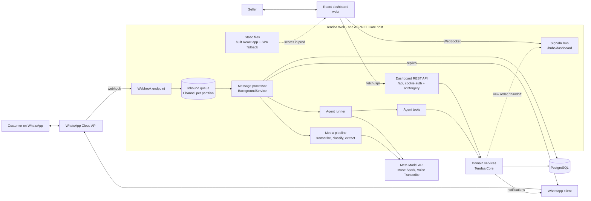
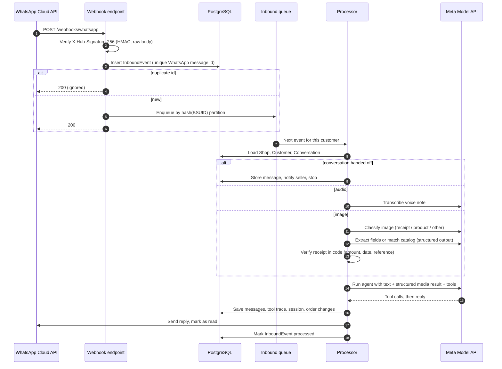
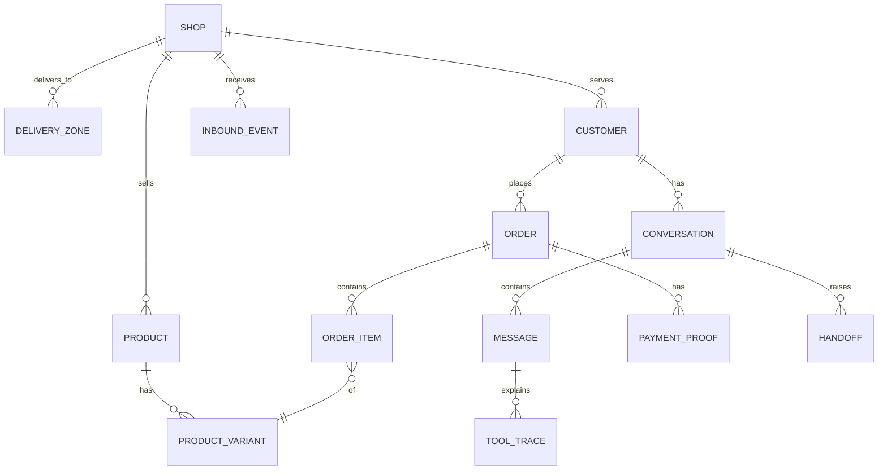

# Architecture

How Tendaa is built, and why. Read with `SPEC.md` (what it does) and `PLAN.md` (build order).

## Principles

1. **The model talks; the code decides.** Prices, totals, stock, order status and payment checks
   are computed in C#. The model chooses tools and writes replies. It never sets a price or
   confirms a payment.
2. **One agent, small focused model calls around it.** A single conversational agent handles the
   chat with tools. Images and audio go through separate, single-purpose model calls (transcribe,
   classify, extract) that return structured data. That keeps each step testable and stops text
   inside an image from reaching the agent as instructions.
3. **Never lose a message.** Every inbound WhatsApp event is saved before we return 200, and
   processing can be retried after a crash.
4. **One customer, one message at a time.** Messages from the same customer (WhatsApp
   business-scoped user ID, not phone number) are processed in order; different customers run in
   parallel.
5. **Multi-tenant from day one.** Every row has a `ShopId`. The MVP has one shop; going live
   means adding onboarding, not rewriting.

## Components

In development, `web/` runs under the Vite dev server on its own port and proxies `/api`, `/hubs`
and `/webhooks` to the ASP.NET Core port, so the dashboard gets hot reload without losing access to
the backend. In production there is one process: `Tendaa.Web` serves the built React app from
`wwwroot` with a fallback to `index.html` for client-side routes.

| Project | Responsibility | Depends on |
|---|---|---|
| `Tendaa.Core` | Entities, order state machine, totals, delivery fees, payment verification rules, domain services, interfaces (`IWhatsAppSender`, `IMediaStore`, ...) | nothing |
| `Tendaa.Agent` | Agent factory, instructions, tools, request context, media pipeline (transcriber, image classifier, receipt extractor, product matcher, price list extractor) | Core, Microsoft.Agents.AI, OpenAI SDK |
| `Tendaa.Infrastructure` | EF Core DbContext, migrations, repositories, WhatsApp Graph API client, media storage | Core |
| `Tendaa.Web` | Webhook endpoints, inbound queue + processor, dashboard REST API (`/api`) + SignalR hub, static hosting of the built React app, auth, DI wiring, config | all |
| `web/` (`Tendaa.Web.Client`) | React dashboard SPA: pages, typed API client generated from `Tendaa.Web`'s OpenAPI document, SignalR connection for live updates | Vite, React, TypeScript, React Router, TanStack Query, Tailwind CSS, shadcn/ui |
| `Tendaa.Evals` (`evals/`) | Console app that runs the eval set against the real model | Agent, Core |

## Inbound message flow

**Crash safety.** `InboundEvent` has a status (`Pending`, `Processed`, `Failed`). On startup, the
processor re-queues `Pending` events. Failed events retry up to 3 times, then show in the
dashboard. This is an inbox pattern, the same idea as a transactional outbox in reverse.

**Ordering.** The queue is N `Channel<InboundEvent>` partitions; each business-scoped user ID
(BSUID) always maps to the same partition and one worker reads each partition — not phone number,
since phone can be absent. Same customer: strictly in order. Different customers: parallel.

**Status webhooks** (sent, delivered, read) are stored for the conversation view and otherwise
ignored.

## Customer identity

WhatsApp's business-scoped user ID (BSUID) is the customer's identity, not the phone number. Since
Meta's username rollout, a user can hide their number entirely; only the BSUID is always present.
Exact field names (confirmed against Meta's [BSUID
docs](https://developers.facebook.com/documentation/business-messaging/whatsapp/business-scoped-user-ids)):

| Where | Phone (optional) | BSUID (always present) |
|---|---|---|
| `contacts[]` | `wa_id` | `user_id` |
| `messages[]` | `from` | `from_user_id` |
| Outbound send | `to` | `recipient` |
| Outbound status (`statuses[]`) | `recipient_id` | `recipient_user_id` |

`contacts[].profile.username` and `contacts[].profile.name` are also sent when WhatsApp has them;
store both when present, never require them.

**Phone is optional, nullable, update-only-when-present.** `wa_id`/`from` are omitted once a user
adopts a username, unless the business messaged them or they messaged the business in the last 30
days, or they're in the business's contact book. A webhook with no phone doesn't mean the customer
lost their number — never clear a previously stored `PhoneNumber` because one event omits it; only
overwrite it when a new value arrives.

**BSUID changes.** Two system messages on `messages[]` (`type: "system"`) link an old BSUID to a
new one via `system.previous_user_id`:
- `user_changed_number`: phone became known or changed. `system.wa_id` = new phone,
  `system.user_id` = new BSUID, `system.previous_user_id` = old BSUID.
- `user_changed_user_id`: phone still unknown. `system.wa_id` is omitted; same `user_id` /
  `previous_user_id` shape.

Both update the existing `Customer` row found by `previous_user_id` in place (new `BsuId`, and
`PhoneNumber` only if `wa_id` is present) — never create a second row.

**Outbound.** Meta's own guidance is to send `to` *or* `recipient`, never both (their example shows
both together, but also documents that `to` wins if present — so sending both doesn't mean "prefer
phone, fall back to BSUID", it just makes `recipient` silently ignored whenever a phone is known).
`IWhatsAppSender` therefore sends exactly one: `to` = phone when `Customer.PhoneNumber` is known,
else `recipient` = `Customer.BsuId`.

**Out of scope.** `parent_user_id` / `from_parent_user_id` (parent BSUIDs, an enterprise
multi-account feature) exist in the API but aren't modeled — not relevant to the MVP's single WABA.

Internally, `CustomerId` is Tendaa's own surrogate key (`Customer.Id`), resolved once per inbound
event from `(ShopId, BsuId)` — find-or-create on first contact, update-in-place on a BSUID-change
system message. Tools and the agent's request context carry this internal `CustomerId`, never the
BSUID or phone directly.

## The agent

One `AIAgent` built from the OpenAI .NET SDK `ChatClient` pointed at Meta Model API.

**Request context.** Before each run, the processor fills a scoped `AgentRequestContext` with
`ShopId`, `CustomerId` (Tendaa's internal id, resolved from the customer's BSUID — see "Customer
identity" above), `Phone` (nullable), and `ConversationId`. Tools read it from DI. The model never
passes these as arguments, so it can't act on another customer's data.

**Tools** (each a thin method over a domain service, returning small JSON-friendly results):

| Tool | Does | Notes |
|---|---|---|
| `SearchProducts(query)` | Find products by name, category, colour | SQL, returns id, name, price, variants in stock |
| `GetProductDetails(productId)` | Full details for one product | `NOT_FOUND` if missing |
| `GetDeliveryFee(area)` | Zone + fee + delivery time for an area | Unknown area returns the zone list |
| `GetShopInfo()` | Hours, rules, payment methods | Rules text from the seller |
| `UpsertDraftOrder(items, customerName, area, address)` | Create or update the customer's draft order | Stock checked; returns missing fields |
| `GetOrderSummary()` | Items, totals, delivery fee, grand total | Totals computed in Core |
| `ConfirmOrderSummary()` | Draft to `AwaitingPayment`, returns bank details | Only after the customer said yes |
| `GetMyOrders()` | This customer's recent orders and statuses | Never other customers' |
| `RequestHandoff(reason, summary)` | Create a handoff, silence the agent on this chat | Seller notified |

There is deliberately **no** tool to confirm payment, change prices, or give discounts.

**Media results are context, not instructions.** After a receipt check or product match, the
processor passes the result to the agent as a structured note (for example
`[receipt_check: amount ₦38,500, matches order 1042, moved to PaymentReview]`). The raw text read
from the image never goes into the agent's prompt.

**Sessions.** One `AgentSession` per conversation, saved as JSON on the `Conversation` row
(`SerializeSessionAsync` / `DeserializeSessionAsync`). History is trimmed to a token budget; order
state lives in the database, not in chat history, so trimming never loses the order.

**Trace.** Agent middleware records each tool call (name, arguments, result, duration) and the
model's reply into `ToolTrace` rows linked to the assistant `Message`. The dashboard shows this as
"why the agent said this".

## Media pipeline

| Step | Model call | Output | Then |
|---|---|---|---|
| Voice note | Muse Voice Transcribe | Transcript + language | Treated as the customer's text; transcript stored |
| Image classify | Muse Spark, structured output | `receipt`, `product`, or `other`, with confidence | Routes to the next step |
| Receipt extract | Muse Spark, structured output | amount, sender, bank, date, reference, confidence | `PaymentVerifier` in Core decides |
| Product match | Muse Spark with the image + catalog list (id, name, colour, category) | Up to 3 product ids with confidence | Ids validated against the DB |
| Price list (dashboard only) | Muse Spark, structured output | Draft products (name, price, variants) | Seller reviews before saving |

`PaymentVerifier` (pure C#, fully unit tested) checks: amount equals the grand total, transfer date
is after the order was created, the reference hasn't been used on another order, confidence is
above a threshold. Any failure leaves the order in `AwaitingPayment` and records why. A pass moves
it to `PaymentReview` only. `Confirmed` requires a seller actor (`OrderStateMachine` throws
otherwise).

Media files are downloaded from the Graph API (media id, then URL, then bytes with the access
token) and stored through `IMediaStore`: local disk in development, object storage later.

## Data model

Key fields:
- `Shop`: name, country, currency, time zone, hours, rules text, bank name, account number, account name, WhatsApp phone number id.
- `Customer`: `BsuId` (WhatsApp business-scoped user id, unique per `ShopId`), `PhoneNumber`
  (nullable, stored when WhatsApp provides it, never cleared just because an event omits it),
  `Username`, `Name` (both nullable, from `contacts[].profile`).
- `ProductVariant`: size/colour, stock, optional price override. Money is `decimal` in the shop's currency (`Shop.Currency`, NGN for the demo).
- `Order`: number (human friendly, per shop), status, item total, delivery fee, grand total,
  zone, address, timestamps per status, `ConfirmedBy`.
- `PaymentProof`: media id, extracted fields (JSON), verification result, reasons, reviewed by.
- `Message`: direction, type (text, audio, image), text or transcript, media id, WhatsApp id.
- `InboundEvent`: WhatsApp message id (unique), raw payload, status, attempts, error.

EF Core global query filters scope every query by the current `ShopId`.

## Order state machine

Defined in `Tendaa.Core.Orders.OrderStateMachine` (see SPEC.md for the diagram). Transitions carry an
actor (`Customer`, `Agent`, `Seller`, `System`). Allowed transitions are a table in code and every
pair is unit tested, including the forbidden ones.

## Seller dashboard

A React SPA in `web/` (`Tendaa.Web.Client`), served as static files by `Tendaa.Web` in production
and by the Vite dev server in development (proxying `/api`, `/hubs` and `/webhooks` to the ASP.NET
Core port). It talks to a REST API under `/api` in `Tendaa.Web`, which calls Core services
in process — same process, same database, just a typed HTTP boundary instead of direct component
binding.

**Typed client, no hand-written request types.** `Tendaa.Web` exposes its OpenAPI document via
`Microsoft.AspNetCore.OpenApi`. `web/` generates a client from that document with
[Orval](https://orval.dev), including TanStack Query hooks, so page code calls generated hooks
(`useGetOrders()`, `useConfirmOrder()`, ...) instead of hand-rolled `fetch` calls or hand-written
request/response types. Orval was chosen over `openapi-typescript` because it generates the
React Query hooks directly from the spec (we already committed to TanStack Query), which is less
glue code to write and keep in sync during a time-boxed build; the trade-off is a heavier
generator and more generated surface than a types-only tool.

Cookie auth with an admin password for the MVP; antiforgery tokens on state-changing requests.
Pages: Orders board, Order detail (receipt beside extracted fields, Confirm/Reject), Conversations
(thread + trace), Handoffs (reply via WhatsApp, resolve), Catalog (edit + price list import),
Settings (shop details, zones, rules). New orders and handoffs appear live through a SignalR
connection (`@microsoft/signalr`) to a hub in `Tendaa.Web`; polling is the fallback if the
connection drops.

## Outbound messages

`IWhatsAppSender` sends text (and later templates), addressing by phone (`to`) when
`Customer.PhoneNumber` is known or by BSUID (`recipient`) otherwise — see "Customer identity"
above. Seller actions (confirm, reject, handoff reply) send through it. The 24-hour customer
service window is checked from the customer's last inbound message; outside it, the MVP shows a
warning in the dashboard instead of sending (templates are a post-hackathon feature).

## Configuration and secrets

Typed options with `ValidateOnStart`: `MetaModel`, `WhatsApp`, `Dashboard`, `ConnectionStrings`.
Development: `dotnet user-secrets`. Production: environment variables. Model names are config so
contributor and standard modes switch without code changes. The frontend (`web/`) holds no
secrets: `web/.env*` only ever has public values like the API base path, and in production that's
usually unset because the SPA and API share an origin.

## Security

- Webhook signature verified with a constant-time compare; unsigned or invalid requests get 401.
- Verify token checked on the GET challenge.
- Tools get identity (the internal `CustomerId`, resolved from the WhatsApp BSUID, never the phone
  number) from the request context only; EF filters enforce shop isolation.
- Prompt injection: image and voice content reaches the agent only as structured fields; agent
  instructions state that customer content never changes its rules; evals include injection cases.
- Dashboard: same-origin cookie auth (admin password for the MVP); antiforgery tokens required on
  state-changing `/api` requests; `[Authorize]` on every `/api` and hub route. No JWT and no CORS
  in production, since the SPA is served from the same origin as the API.
- No secrets or real phone numbers in the repo; the repo is public.
- Personal data (names, phones, addresses) is kept to what orders need. While on free API credits,
  only demo and role-play data is sent to the model.

## Testing

| Level | What | How |
|---|---|---|
| Unit | State machine, totals, delivery fees, `PaymentVerifier`, tools | xUnit, in-memory fakes |
| Agent loop | Tool calling end to end without the real API | OpenAI SDK with a fake `HttpClient` transport returning scripted completions |
| Web | Webhook verify, signature, dedupe, ordering, dashboard API auth | `WebApplicationFactory`, Testcontainers or Docker Postgres |
| Frontend | Lint, strict type-check, build | `npm run lint`, `npm run build` (runs `tsc --noEmit` as part of the build) |
| Evals | 25 to 30 real conversations against Muse Spark | `Tendaa.Evals` console, score table |

## Deployment

A multi-stage Dockerfile: a Node stage runs `npm ci && npm run build` for `web/` and copies its
output into `Tendaa.Web`'s `wwwroot`; a .NET stage publishes `Tendaa.Web` (with ffmpeg if voice
notes need converting) on top of that, so the result is still one container. Plus managed
PostgreSQL on Railway or DigitalOcean. Migrations run on startup in the demo environment. `/health`
endpoint. WhatsApp webhook pointed at `https://<host>/webhooks/whatsapp`. Local development uses a
cloudflared or ngrok tunnel.

**Two run modes.** Development: two processes — `dotnet run` for `Tendaa.Web` (webhooks, dashboard
API, hub) and `npm run dev` for `web/` (Vite, proxying `/api`, `/hubs`, `/webhooks` to the .NET
port) — so the dashboard gets hot reload. Production: one process; `Tendaa.Web` serves the built
React app as static files with an `index.html` fallback for client-side routes.

## Decisions and trade-offs

| Decision | Why | Alternative not taken |
|---|---|---|
| One agent + focused media calls | Testable, cheaper, contains prompt injection | Multi-agent orchestration: more moving parts for no gain at this size |
| No vector database in the MVP | Catalog is structured (SQL), rules fit in the prompt | pgvector RAG: add when a shop has large unstructured documents |
| Receipt verification in code | Deterministic, auditable, can't be talked out of it | Letting the model judge the receipt |
| Seller confirms every payment | Screenshots can be faked | Auto-confirm: unsafe without bank or Paystack verification |
| Inbox table + Channel partitions | No lost messages, per-customer order, no extra infrastructure | Azure Service Bus / RabbitMQ: overkill for the MVP |
| React SPA (`web/`) + REST API, same repo/host | A dashboard UI I can grow into a real product after the hackathon, with the component and hiring ecosystem that implies; still one deployable via a multi-stage Docker build | Blazor Server: one language, less to build during the hackathon — but trading that build-time simplicity for a weaker long-term base for the dashboard. Honest cost of the choice made: a second stack, a REST API surface to design and test, and generated-client plumbing that Blazor would not have needed |
| ShopId everywhere now | Multi-tenant later without migration pain | Single-tenant schema |
